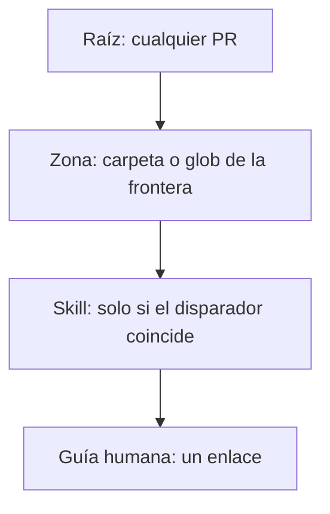

# Capítulo 2 — Apilar contexto para un agente

Este capítulo se lee sin conocer un producto concreto. Al terminar tienes que poder explicar en voz alta cómo apilar contexto: raíz, zona, procedimiento, guía por enlace. El capítulo 1 definió la frontera. Este dice qué texto cargar para esa frontera. Qué pieza usar cuando el texto no basta —skill, subagente, hook, persona— es el capítulo 3.

Cada idea usa el mismo bloque: **qué es → por qué importa → best practice → ejemplo corto → ejercicio mental**.

*Documentación consultada el 8 oct 2026. Enlaces al final.*

**Objetivos.** Diseñar la pila de contexto de un turno. Escribir la zona de una frontera sin copiar la guía humana y sin dejar dos órdenes opuestas. Revisar contexto ajeno con la rúbrica de abajo.

### El contexto se apila en cuatro capas

1. **Qué es** — El contexto son las instrucciones que el agente carga antes de editar. Se apilan de lo general a lo específico. (1) **Raíz:** lo que es verdad en cualquier carpeta. En la práctica, un `AGENTS.md` en la raíz del repo, o una regla (rule) con `alwaysApply: true`. (2) **Zona:** el contrato de una frontera. O un `AGENTS.md` dentro de esa carpeta, o una regla con glob. Un glob es un patrón de rutas, por ejemplo `services/payments/**`. (3) **Skill:** un procedimiento con disparador. El cuerpo no entra en cada edición. (4) **Guía humana:** el documento de estilo del equipo, al que se llega por un enlace. Cada capa añade. Ninguna repite a la de arriba.
2. **Por qué importa** — Un fichero único y enorme se desfasa (drift: la copia y el original dejan de decir lo mismo). El agente se trae al PR las normas de otra zona, o trabaja sin las de la frontera y el blast radius del diff sorprende a quien aprueba. Cargar el procedimiento en la raíz lo paga cada turno que no lo necesita.
3. **Best practice** — Antes de editar, escribe la pila del turno en una línea: raíz, zona, skill si la tarea lo pide, enlaces. Nombra también lo que dejas cerrado. Los cuatro tipos de regla de Cursor (siempre, glob, a petición del agente, manual) y la carga por capas de una skill están en el capítulo 3. Aquí solo hace falta no meter en la zona un texto que pertenece a otra capa.

4. **Ejercicio mental** — Vas a cambiar un test de una sola feature. ¿Qué capas abres y cuál dejas cerrada?

### La raíz es el contrato de cualquier PR

1. **Qué es** — El fichero raíz dice lo que es verdad en todas las carpetas: principios, la puerta humana nombrada, los comandos canónicos y un índice corto de dónde viven las reglas locales. `AGENTS.md` es markdown plano: el formato abierto no exige campos ni una versión. El manual de un equipo no va aquí. Una regla siempre-activa hace el mismo papel cuando hace falta el fichero `.mdc` de Cursor; un `.md` suelto en `.cursor/rules` no cuenta.
2. **Por qué importa** — Casi todo turno empieza en la raíz. Si la raíz está llena de normas de un equipo, esas normas contaminan PRs de otros equipos. Si faltan los comandos, el agente inventa uno. Si la puerta no está nombrada, el push parece un paso más. Nombrarla no lo bloquea: el mecanismo es el capítulo 3.
3. **Best practice** — En la raíz solo entran reglas que aplicarías a un PR de cualquier carpeta. Lo demás baja a la zona o a una skill. Cursor pide reglas cortas, por debajo de 500 líneas, un tema por fichero.
4. **Ejemplo** — La raíz de un monorepo de pagos dice: la web y el servicio van en PRs distintos cuando no salen el mismo día; el test del servicio es el comando que el repo documenta; antes del push, resumen y espera. El checklist de esos tests no está en la raíz.
5. **Ejercicio mental** — Cita tres reglas que deban estar en la raíz de tu repo y una que estaría de más ahí.

### La zona coincide con la frontera

1. **Qué es** — El fichero de zona añade el contrato de una frontera: patrones locales, enlaces y modos de fallo (failure mode: qué se rompe, y en qué orden, si ignoras la regla). Hay dos formas, y no hacen lo mismo. Un `AGENTS.md` en la carpeta entra al trabajar en ese directorio o en uno hijo. Cursor lo combina con los de las carpetas padre, y la instrucción más específica tiene prioridad. El formato abierto dice que manda el fichero más cercano al archivo editado, y que el mensaje de la persona manda sobre el fichero. Una regla `.mdc` con glob entra cuando hay un fichero que coincide con el patrón: sirve cuando la frontera es un tipo de fichero, no una carpeta entera. Una regla solo con `description`, sin glob, no es una zona: el agente puede no cargarla.
2. **Por qué importa** — Sin ámbito, la norma de un equipo se vuelve norma del monorepo. Un glob más ancho que la frontera agranda el blast radius de la regla. Un glob más estrecho deja al agente editando al lado de la frontera sin verla. Tratar el `globs` escrito dentro de un `AGENTS.md` como el interruptor es otro error: la documentación de Cursor describe ese fichero como markdown sin metadatos, y lo enciende la carpeta.
3. **Best practice** — El ámbito coincide con la frontera del capítulo 1. Carpeta del equipo: `AGENTS.md` dentro. Un tipo de fichero que atraviesa carpetas: regla con glob. Ni el repo entero ni un fichero suelto si la norma es de la carpeta.
4. **Ejemplo** — `services/payments/AGENTS.md` vale para ese servicio. «Los componentes exportan por nombre» es una regla con glob `web/**/*.tsx`, porque dentro de `web/` hay más cosas que componentes.
5. **Ejercicio mental** — Si el glob fuera `**/*`, ¿qué PR de otro equipo quedaría sujeto a reglas que no le tocan?

### Una skill es el procedimiento, no la zona

1. **Qué es** — Una skill es un procedimiento con disparador: cómo escribir los tests de pagos, cómo revisar una migración. Vive en su `SKILL.md`. Al arrancar, el agente ve el nombre y la description; el cuerpo entra cuando la tarea coincide. El capítulo 3 explica esa carga, cuándo invocarla a mano y cuándo el procedimiento es en realidad un hook o un subagente.
2. **Por qué importa** — Si el procedimiento vive en la raíz o en la zona, se carga en turnos que no lo necesitan y envejece lejos de quien lo mantiene. Si vive solo en la cabeza del revisor, el agente entrega trabajo que el review rechaza por un criterio que no estaba escrito.
3. **Best practice** — «Cuando hagas X, sigue estos pasos» es una skill, enlazada desde la zona. «En esta carpeta no hagas Y» es una regla de zona. Si la skill repite otra, el paso repetido es un enlace, no una copia.
4. **Ejemplo** — La zona de pagos enlaza la skill `payment-tests` y no pega el checklist. La description de la skill dice: úsala al añadir o revisar tests de ese servicio.
5. **Ejercicio mental** — Una checklist de tests de tu equipo. ¿Aplica en cada edición o solo cuando alguien escribe tests? Eso decide si es regla o skill.

### La guía humana se enlaza

1. **Qué es** — La guía de estilo la mantienen las personas, en la documentación del repo. Es la fuente única (single source of truth): un solo sitio manda. El fichero del agente guarda el enlace y, como mucho, la excepción local que la guía no cubre. El texto largo no se copia.
2. **Por qué importa** — Copiar la guía dentro de las instrucciones crea drift. El día que la guía cambia, el agente obedece la copia vieja y el review obedece la nueva. El PR tiene dos contratos. El blast radius de ese desfase es cada turno hasta que alguien nota la contradicción. La propia guía de reglas de Cursor dice lo mismo: no pegues la guía de estilo; el agente ya conoce las convenciones comunes, y un linter las cumple mejor que un párrafo.
3. **Best practice** — Una regla, un sitio. El fichero del agente enlaza, y dice qué mirar en ese enlace. Ahí solo se escribe lo que la guía no dice y esta frontera necesita. Referenciar un fichero con `@` no pega su contenido en el prompt: el agente lo lee si le hace falta. Lo que tenga que estar siempre, va escrito en la regla.
4. **Ejemplo** — La guía de la web vive en `docs/web-style.md`. `web/AGENTS.md` enlaza esa guía y añade una línea: en los recibos, el nombre del comercio usa el componente que la guía ya nombra, no uno nuevo.
5. **Ejercicio mental** — Si mañana cambia una convención de nombres, ¿cuántos ficheros habría que tocar para que el agente se entere? La respuesta sana es uno.

### La zona especializa; el conflicto se escribe

1. **Qué es** — La zona puede concretar la raíz. No puede dejar dos órdenes vivas. Si la raíz pide separar cambios que se despliegan en ritmos distintos y la zona pide subirlos juntos, hay dos contratos. En ejecución no gana «la raíz por ser la raíz». En un `AGENTS.md` anidado, Cursor da prioridad a la instrucción más específica. Las reglas de equipo, si existen, se mezclan con las del repo y ganan si chocan. El mensaje de la persona manda sobre el `AGENTS.md`.
2. **Por qué importa** — La contradicción no se ve en el diff. Se ve con el PR ya abierto, o no se ve: el fichero más cercano gana y el review sigue leyendo la raíz. El equipo deja de fiarse del contexto y vuelve a pegar reglas en el chat. A partir de ahí cada turno tiene el blast radius de una norma oral.
3. **Best practice** — Al añadir una regla de zona, busca en la raíz la frase del mismo tema. Si chocan, o la raíz nombra la excepción, o reescribes la regla local. Dos verdades a la vez no son un contrato, aunque el runtime ya haya elegido una.
4. **Ejemplo** — La raíz dice que web y servicio van en PRs distintos. Pagos necesita una excepción el día del lanzamiento, cuando los dos salen juntos. La raíz nombra esa excepción. La zona no la contradice en silencio.
5. **Ejercicio mental** — Inventa una regla de equipo que choque con «separa por cadencia». ¿Cuál gana en ejecución, y qué frase habría que añadir a la raíz para que la excepción sea legal?

### El contexto nombra el comando y el modo de fallo

1. **Qué es** — Un contexto accionable dice el comando que ya existe en el repo para validar, y el modo de fallo: qué se rompe, y en qué orden, si lo ignoras. «Sigue las convenciones» no cambia ninguna decisión. «Ejecuta este comando y no edites la salida» sí.
2. **Por qué importa** — En el hueco, el agente inventa un comando. El review recibe un PR que no corre lo que corre el CI. El modo de fallo es lo que permite parar antes de cruzar la frontera: compatibilidad entre versiones, fichero generado, secreto, test que no prueba comportamiento.
3. **Best practice** — Cada fichero de zona incluye al menos un comando copiado de la lista canónica del repo y dos frases del tipo «si haces X, se rompe Y». Si el comando no existe, el trabajo es añadirlo al sitio de comandos del repo, no inventarlo en las instrucciones.
4. **Ejemplo** — La zona de pagos nombra el comando de test que el repo ya usa. Si cambias el schema y no regeneras el cliente, la web compila contra un tipo que producción no tiene. El comando de regeneración es el que documenta el repo, escrito al lado.
5. **Ejercicio mental** — Una instrucción que diga «lanza los tests». ¿Sabrías el comando exacto sin preguntarle a nadie? Si no, el agente tampoco.

## Capítulo 2 · Laboratorio

Escribe un fichero de contexto de zona, ficticio, para el servicio de pagos. Antes del texto, una línea: por qué es un `AGENTS.md` en la carpeta, o por qué es una regla con glob.

Secciones obligatorias:

- ámbito que coincida con esa frontera y con nada más
- enlaces a la guía humana (el texto de la guía no se pega)
- una skill enlazada, no pegada; si no hay procedimiento, un comando de test sacado de la lista canónica del repo
- tres reglas que no estén ya en la raíz
- dos modos de fallo («si haces X, se rompe Y»)
- el comando real que regenera, si la frontera tiene salida generada; si no lo tiene, una línea que diga que no aplica

Segunda parte, de review. Redacta tú mismo un párrafo de raíz y un párrafo de zona que choquen en tres sitios: cadencia, comando de validación, y qué fichero es la fuente de algo generado. Para cada choque, di cuál gana en ejecución y la frase que falta para que dejen de contradecirse.

## Capítulo 2 · Rúbrica

Un contexto bueno se puede obedecer sin preguntar y se puede revisar como un contrato.

| Criterio | Aprueba | No aprueba |
| --- | --- | --- |
| Accionable | Dice qué hacer y con qué comando del repo | «Sigue las convenciones del equipo» |
| Acotado | El ámbito es la frontera: carpeta o glob, y se dice cuál | El ámbito es el repo entero, o no hay ámbito |
| Referencial | Enlaza la guía humana | Pega la guía, o la parafrasea entera |
| Modos de fallo | Nombra qué se rompe si se ignora la regla | Solo lista preferencias de estilo |
| Compatible | La excepción está escrita, o no hay choque | Dos frases opuestas y nadie dice cuál manda |
| Pila | Se ve qué es regla permanente y qué es skill | El procedimiento de un solo tipo de tarea está en la raíz o en la zona |

La rúbrica se aplica al fichero del laboratorio y a los tres choques de la segunda parte. Una frase que no cambia una decisión del agente no puntúa en «accionable».

## Capítulo 2 · Anti-patrones

### Pegar la guía dentro de las instrucciones

1. **Qué es** — El fichero del agente reproduce páginas de la guía de estilo «para que no tenga que buscar».
2. **Por qué importa** — Hay dos fuentes. El review usa la guía viva y el agente usa la copia. El PR cumple un contrato caducado. Eso es drift.
3. **Best practice** — Un enlace y, si hace falta, una excepción de pocas líneas que la guía no contempla.
4. **Ejercicio mental** — ¿Cuánto de tu fichero de instrucciones seguiría siendo verdad si la guía cambiara mañana?

### Dos verdades para el mismo PR

1. **Qué es** — La raíz y la zona dan órdenes opuestas sobre cadencia, comandos o ficheros generados, y ninguna dice que es una excepción.
2. **Por qué importa** — En ejecución puede ganar la más específica, no la que el review está leyendo. El agente elige una, el revisor exige la otra, y el equipo acaba escribiendo la norma real en el chat.
3. **Best practice** — Cada regla de zona se lee al lado de la raíz antes de mergear el fichero de contexto. El choque se resuelve en el texto, no en el review del PR de producto.
4. **Ejercicio mental** — ¿Qué regla ganaría en ejecución, y dónde quedaría escrita la que pierde?

### Comandos que el repo no tiene

1. **Qué es** — El contexto dice «corre los tests» o «regenera» sin el comando que el gestor de paquetes, el Makefile o el CI ya usan.
2. **Por qué importa** — El agente rellena el hueco. El PR local queda en verde con una orden distinta a la del pipeline, y el review descubre el fallo cuando el check ya ha caído.
3. **Best practice** — Copia el comando desde la lista canónica. Si el comando no existe, se añade al sitio de comandos del repo.
4. **Ejercicio mental** — ¿El comando que recordarías de memoria es el mismo que corre el PR?

## Límite de este capítulo

La pila dice qué texto cargar. No elige la frontera: eso es el capítulo 1. No decide si el procedimiento es una skill, un subagente o un hook, ni bloquea un push: eso es el capítulo 3. Un fichero de zona perfecto sobre la frontera equivocada sigue teniendo el blast radius equivocado. Y una plantilla llena de frases que no cambian decisiones («ve con cuidado», «sigue los patrones») aprueba una lectura superficial y suspende la rúbrica.

## Fuentes

Consultadas el 8 oct 2026.

- Reglas, tipos, `AGENTS.md` anidado, no copiar la guía, referenciar ficheros: [cursor.com/docs/rules](https://cursor.com/docs/rules)
- Formato abierto, sin campos obligatorios; manda el fichero más cercano; el mensaje de la persona manda sobre el fichero: [agents.md](https://agents.md/)
- La description de una skill es lo que el agente usa para decidir si la abre: [cursor.com/docs/skills](https://cursor.com/docs/skills)
