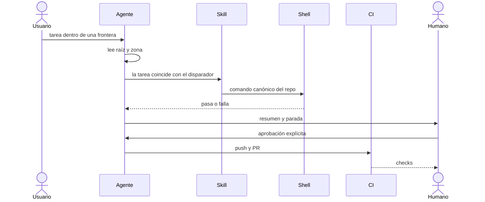

# Capítulo 3 — Topología: quién hace qué en un turno

Este capítulo se lee sin conocer Grafana. Al terminar tienes que poder explicar en voz alta tres cosas: cuándo se abre una skill, cuándo se para para una persona, y para qué sirve un punto de restauración (restore point). Grafana es un ejemplo por principio. Las rutas de apoyo siguen en [example-map.md](../example-map.md).

Cada idea usa el mismo bloque: **qué es → por qué importa → best practice → ejemplo corto → ejercicio mental**.

Hace falta el capítulo 2. Allí una regla de zona vale en cada edición de esa carpeta, y una skill es un procedimiento con disparador. Aquí se decide cuál de las dos toca, y cuándo no toca ninguna: toca una persona.

*Hechos de Grafana comprobados en `main` de novarz/grafana el 8 oct 2026 (commit `142e558`).*

**Objetivos.** Dibujar el reparto de un turno: agente generalista, skills, humano y harness. Decidir entre skill, fichero de instrucciones y aprobación humana. Encadenar skills sin copiarlas. Parar antes de un efecto difícil de deshacer.

### Un turno tiene cuatro papeles

1. **Qué es** — La topología es el reparto de un turno. Hay cuatro papeles. El **agente generalista** lee el contrato del repo y edita dentro de la frontera del capítulo 1. Una **skill** es un procedimiento con disparador: se abre cuando la tarea coincide, y se cierra al terminar. El **humano** ocupa las puertas: aprueba lo que no se deshace con otro edit, y arranca lo que no pertenece a la terminal del agente. El **harness** es el entorno de ensayo: estado conocido y un restore point para volver a él. El ensayo no es el producto; el reparto sí viaja.
2. **Por qué importa** — Un solo agente que hace de los cuatro elige el procedimiento, publica y deja el repo sin forma de volver. El blast radius (quién se rompe si el cambio va mal) pasa a ser «lo que el modelo decidió en este chat». El review no tiene un papel al que señalar.
3. **Best practice** — Antes del turno, una línea: quién edita, qué skill si la tarea lo pide, qué espera a la persona, cuál es el restore point. Un papel en blanco se dice en voz alta. «El agente ya se apañará» no es un papel.
4. **Ejemplo (Grafana, opcional)** — El contrato raíz declara agentes de zona por directorio y, al lado, skills que se abren por tarea. El agente de la raíz no se traga esos procedimientos en cada edición. [AGENTS.md](https://github.com/novarz/grafana/blob/main/AGENTS.md)
5. **Ejercicio mental** — En el último turno que aceptaste, ¿qué papel hiciste tú y cuál estaba escrito en el repo?

### Regla, skill o persona

1. **Qué es** — Tres sitios distintos, y solo uno encaja. Una **regla** (raíz o zona) se cumple en cada edición de su ámbito: «en esta carpeta no hagas Y». Una **skill** responde a un disparador: «cuando hagas X, sigue estos pasos». Una **persona** entra cuando el paso publica o cambia algo fuera del diff (un side-effect: un efecto que no se deshace editando otra línea). El capítulo 2 separó regla y skill. La persona es el tercer sitio.
2. **Por qué importa** — El procedimiento metido en la raíz se carga en turnos que no lo necesitan y envejece lejos de quien lo mantiene. La puerta metida dentro de la skill hace que un disparador publique solo. Pedir aprobación para cada test para el turno, y el equipo acaba saltándose la puerta de verdad.
3. **Best practice** — Tres preguntas, en orden. ¿Vale en cada edición de esta carpeta? Es regla. ¿Es un cómo, y solo cuando la tarea aparece? Es skill. ¿Publica, mergea, force-pushea o dispara otro sistema? Es persona. Si dudas entre las dos primeras, es skill: una regla que no aplica en cada edición estorba.
4. **Ejemplo (Grafana, opcional)** — El guion del presentador lo dice en una línea: la regla dice qué hay que cumplir; la skill dice cómo. [`.cursor/101-SCRIPT.md`](https://github.com/novarz/grafana/blob/main/.cursor/101-SCRIPT.md)
5. **Ejercicio mental** — Una norma de cada edición en la carpeta, un procedimiento al escribir una migración, y un push. ¿Cuál es regla, cuál skill, cuál persona?

### Una skill llama a otra; no la copia

1. **Qué es** — Una cascada es una skill que, en un paso, manda a abrir otra. La especializada dice «lee primero la general» y solo añade lo suyo. La general dice en qué caso hace falta la especializada. Copiar los pasos de la general dentro de la especializada no es una cascada: son dos checklists.
2. **Por qué importa** — El día que el criterio general cambia, el agente obedece la copia y el review exige el original. El mismo fallo del capítulo 2 (una regla, un sitio), ahora entre procedimientos. El blast radius es cada turno que escribe ese tipo de test hasta que alguien nota que las dos skills discrepan.
3. **Best practice** — Si la skill nueva repite más de un paso de otra, ese paso es un enlace y una frase de qué añade la nueva. El disparador de la especializada cabe en la descripción de la general, para que el agente sepa cuándo bajar.
4. **Ejemplo (Grafana, opcional)** — La skill de paneles abre diciendo que se apoya en la de frontend y que hay que leerla antes. Lo suyo es el panel y el canvas. Si hace falta un selector de prueba, manda a la skill de selectores. [`.cursor/skills/panel-testing-strategy/SKILL.md`](https://github.com/novarz/grafana/blob/main/.cursor/skills/panel-testing-strategy/SKILL.md)
5. **Ejercicio mental** — Tu skill de migraciones repite el comando de tests que ya está en otra. ¿Qué línea sustituye a esa copia?

### La persona corta lo que no se deshace

1. **Qué es** — Una puerta humana (human review gate) es un borde del sistema: el agente se detiene, enseña el resumen y espera una instrucción distinta de la tarea original. En el contrato de este laboratorio la puerta está antes de `git push`. Abrir el PR empuja, así que la puerta cubre los dos. «Abre un PR» escrito en la tarea es la intención. El permiso es otra frase, dicha después de ver el diff.
2. **Por qué importa** — Push, force-push de una rama compartida, merge y disparar otro sistema (un webhook: una llamada que otro servicio hace solo porque cambió un estado) no se deshacen con deshacer el edit. Si la skill los incluye como paso normal, el disparador «escribe el test» publica. El capítulo 0 nombró la puerta. Aquí es un papel: alguien concreto, en un punto concreto de la secuencia.
3. **Best practice** — La skill corre el comando de validación del repo. El paso que empuja, mergea o force-pushea no va dentro de la skill. Va detrás de una parada, con el resumen delante: qué ficheros, qué comando corrió, qué no se tocó. La puerta está escrita en la raíz, no en el chat de hoy.
4. **Ejemplo (Grafana, opcional)** — Antes de `git push`, parar y pedir aprobación explícita. Cuando el cambio está listo, mostrar el resumen y esperar. [AGENTS.md](https://github.com/novarz/grafana/blob/main/AGENTS.md), sección Human Review Gates.
5. **Ejercicio mental** — La tarea dice «abre el PR si los tests pasan». ¿Qué frase falta para que el agente pueda empujar?

### Quien presenta arranca el producto

1. **Qué es** — En un ensayo en vivo hay dos terminales. La de la persona arranca el producto, con el Node pinado del repo, y lo deja caliente antes de la sala. La del agente edita, corre los tests que nombra la skill y se detiene. No arranca el servidor de desarrollo, ni el empaquetador del frontend (webpack), ni el comando de arranque largo del backend. El guion es de la persona: máquina, sala, tiempos. Lo que el agente cumple sigue estando en el contrato del repo.
2. **Por qué importa** — Un servidor largo en la terminal del agente ata el ensayo a una sesión que la sala no ve, y a menudo a otro Node. El fallo típico de este laboratorio: el agente de nube trae un Node distinto del fichero `.nvmrc`, el frontend no carga, y el agente «arregla» reiniciando. Reiniciar tapa el fallo y no lo explica. El modo de fallo (failure mode) es ese: el síntoma se confunde con un bug del cambio.
3. **Best practice** — Escribe el reparto en el harness: qué proceso arranca la persona, en qué terminal, con qué versión, y la frase que prohíbe arrancarlo desde el agente. Si la página no carga, el agente para y lo cuenta. No reinicia el producto.
4. **Ejemplo (Grafana, opcional)** — El guion pide Grafana caliente en la terminal de login de quien presenta, con Node v24.11.0, y prohíbe arrancar webpack desde una pestaña de agente. [`.cursor/101-SCRIPT.md`](https://github.com/novarz/grafana/blob/main/.cursor/101-SCRIPT.md)
5. **Ejercicio mental** — El día de la demo, ¿quién arranca el servidor y en qué terminal? Si la respuesta es «el agente, que es más rápido», el reparto no está escrito.

### El restore point es un pin con nombre

1. **Qué es** — Un restore point es un pin: un commit o una rama congelada a la que el harness vuelve. La punta de la rama de trabajo es otro sitio: se mueve con cada merge. La skill de reset es el contrato de esa vuelta (cuándo se invoca, qué deja fuera, dónde para). El script es el mecanismo: mueve el git. En este laboratorio el pin se llama `demo/start`. La skill lo aplica a `main` local, limpia los restos del ensayo y cierra los PR de ramas `cursor/*` que quedaron abiertos. El script no toca el tablero de tickets ni arranca la aplicación. La skill sí devuelve ese tablero al estado inicial, y luego para.
2. **Por qué importa** — Volver a la punta de `main` después de mezclar el ensayo deja el ensayo dentro del producto. El siguiente grupo hereda el cambio de la demo y cree que es el estado limpio. Mover el pin, o force-pushear `main` remoto para deshacer ese merge, es otro side-effect: queda fuera del camino por defecto. Hay un segundo ref, `demo/sdfd-1-backup`, que es el paracaídas de la sesión en vivo. Volver ahí muestra el trabajo de esa sesión, no el estado limpio.
3. **Best practice** — El harness nombra el pin y el comando. Invocar la skill de reset es la confirmación de lo que esa skill documenta, incluido cerrar los PR sobrantes del ensayo. El flag que reescribe `main` remoto, y el push que mueve el pin cuando lo mezclado es solo material del ensayo, los ejecuta una persona. La skill no pasa tickets a «en curso»: en este laboratorio eso dispara el webhook.
4. **Ejemplo (Grafana, opcional)** — [`reset-demo`](https://github.com/novarz/grafana/blob/main/.cursor/skills/reset-demo/SKILL.md) corre `bash .cursor/reset-demo.sh`, que fija `main` local en `origin/demo/start`. `--force-push-main` reescribe `main` en GitHub; el fichero lo deja como flag, fuera del camino por defecto. Mover el pin tras un merge solo del material de ensayo es otro push: `git push origin origin/main:demo/start`.
5. **Ejercicio mental** — El ensayo se mezcló en `main`. ¿A qué ref vuelves, y quién puede mover ese pin?

## Capítulo 3 · Laboratorio

Dos entregas, en papel. No se ejecuta nada contra el repo de ejemplos y no se mergea ninguna skill.

**Flujo con restore point.** Escribe la secuencia, con un sujeto por frase:

1. El pin, anotado antes de tocar nada.
2. El agente implementa en una rama de ensayo. No hace push.
3. La persona arranca la aplicación en su terminal y comprueba que responde.
4. La skill de reset vuelve al pin. El agente se detiene y no rearranca la aplicación.

Si anclas el flujo a Grafana, la skill es `reset-demo`, el pin es `origin/demo/start`, y la aplicación la arranca la persona. Un solo path.

**Skill nueva, solo especificación.** Redacta un `SKILL.md` de `go-migration-check`. No va al repo de Grafana. Secciones obligatorias:

- cabecera con `name` y `description`; la description dice el disparador (cuándo abrirla) y un caso en que no se abre
- pasos que usan un comando que el repo ya tiene; si no puedes citarlo, el paso dice «pedir el comando», no inventa uno
- dos modos de fallo («si haces X, se rompe Y»)
- la parada: la skill no hace push, no force-pushea y no aplica la migración contra una base compartida
- si necesita otra skill, un enlace; el texto de la otra no se pega

Si el ancla es Grafana, las migraciones viven en `pkg/services/sqlstore/migrations/`. El contrato raíz manda probarlas con `make devenv sources=postgres_tests,mysql_tests` y después `make test-go-integration-postgres`. [AGENTS.md](https://github.com/novarz/grafana/blob/main/AGENTS.md)

## Capítulo 3 · Evaluación

Entregable: un diagrama de secuencia del flujo del laboratorio (o de la skill nueva, si prefieres ese turno). Actores, en este orden: usuario, agente, skill, shell, CI, humano. CI es la integración continua: los checks que corren cuando el cambio ya salió del editor.

La forma de referencia. El tuyo sustituye las etiquetas genéricas por el nombre de la skill, el comando y la acción exacta que espera.

| Criterio | Aprueba | No aprueba |
| --- | --- | --- |
| Disparador | Se distingue regla, skill y persona en el flujo | Todo paso es «el agente lo hace» |
| Parada | La flecha hacia CI sale después del humano | El agente empuja porque la tarea decía «abre el PR» |
| Skill | El `SKILL.md` tiene disparador, comando real, dos fallos y la parada | Una checklist genérica, o un comando que el repo no tiene |
| Cascada | Si repite otra skill, enlaza | Pega el procedimiento entero |
| Pin | El flujo nombra el restore point y quién vuelve a él | «Volver a main» sin decir qué commit |

Alguien que no conoce el producto tiene que poder narrar el diagrama en voz alta: cuándo se abre la skill, dónde se para, y qué se recupera con el pin.

## Capítulo 3 · Anti-patrones

### Un agente monolítico, sin skills

1. **Qué es** — Todo el cómo vive en el prompt del turno o en un único fichero de instrucciones: tests, reset, migraciones, selectores.
2. **Por qué importa** — El procedimiento se carga en turnos que no lo piden, y el que sí lo pide recibe una versión que nadie mantiene. El review rechaza el diff por un criterio que no estaba en el disparador.
3. **Best practice** — Lo que tiene disparador se va a una skill. La raíz se queda con las reglas que valen en cualquier PR.
4. **Ejercicio mental** — ¿Qué trozo de tu último prompt solo servía para un tipo de tarea? Ese trozo es una skill que todavía no existe.

### La skill publica sola

1. **Qué es** — El procedimiento de implementar termina en `git push`, en abrir el PR, en mergear o en force-pushear, sin una parada escrita.
2. **Por qué importa** — El disparador «haz el cambio» se convierte en permiso para un side-effect. El review ve el PR cuando ya no puede impedir el push. Deshacer en la rama remota es otro incidente.
3. **Best practice** — La skill acaba en el resumen: ficheros, comando, resultado. La frase siguiente la dice una persona.
4. **Ejercicio mental** — Tacha de tu skill cada línea que no puedas deshacer con otro commit. Lo tachado, ¿tiene una parada delante?

### Volver a la punta de main

1. **Qué es** — Después del ensayo, alguien restaura haciendo checkout de la rama principal, o borra la rama de trabajo y da por limpio el repo. El pin con nombre no se usa.
2. **Por qué importa** — Si el ensayo se mezcló, esa punta ya es el ensayo. El grupo siguiente construye encima. En este laboratorio el pin es `demo/start`. Otro ref guardado como paracaídas de la sesión en vivo tampoco es el estado limpio.
3. **Best practice** — El comando de restauración está en la skill, nombra el pin, y no reescribe la rama remota salvo flag explícito de una persona.
4. **Ejercicio mental** — Si mañana el pin y la rama principal divergen, ¿cuál de los dos enseñas como estado inicial, y dónde está escrito?

## Límite de este capítulo

La topología dice quién actúa. No inventaría las herramientas permitidas: eso es el capítulo 4. No sustituye el pipeline de CI ni los dueños: eso es el capítulo 5. Una skill con el comando correcto, que aun así empuja, suspende la rúbrica.

Hay una contradicción real en el laboratorio, comprobada el mismo día, entre dos ficheros. El contrato raíz prohíbe arrancar el servidor desde el agente y prohíbe el push sin aprobación. En la sala, el guion coincide con lo primero: la persona arranca Grafana y el prompt del agente de nube lo repite. Ese mismo prompt de sala, y el prompt desatendido del 201, dicen abrir el PR sin esperar review. El del 201 además manda arrancar el servidor (no el `make run`) y prohíbe el merge. Hasta que la raíz nombre esas frases como excepción de ensayo, el agente tiene dos contratos. Este capítulo enseña el de la raíz.
