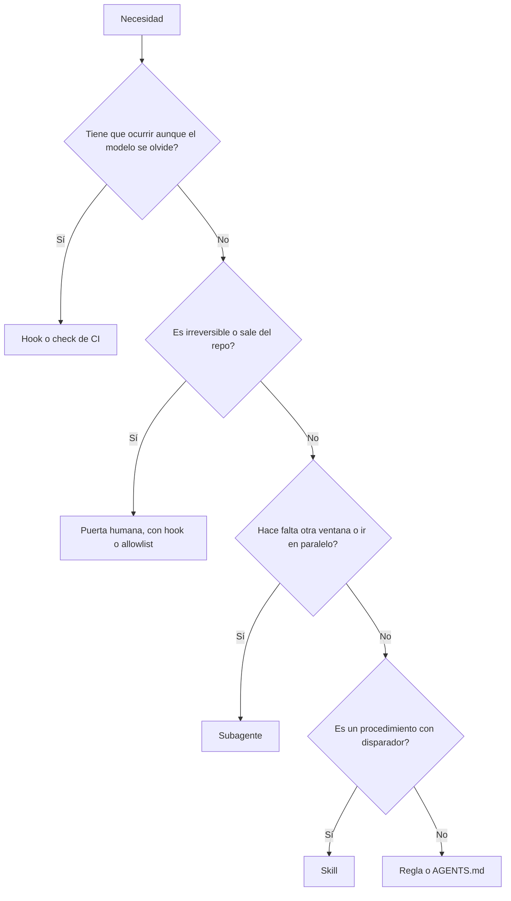
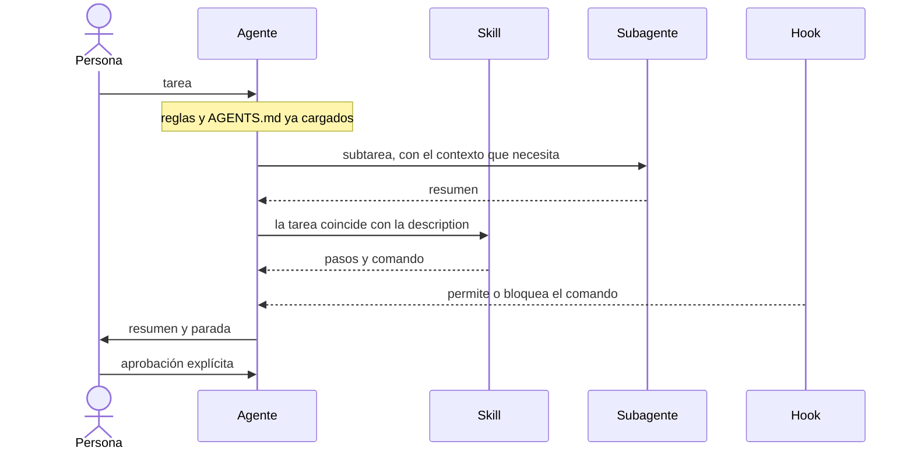

# Capítulo 3 — Topología: qué pieza para cada necesidad

Este capítulo se lee sin conocer un producto concreto. Al terminar tienes que poder explicar en voz alta qué es cada pieza, cuándo usarla y cómo dibujar la topología de tu repo.

El capítulo 2 dice qué contexto cargar: raíz, zona, procedimiento, guía por enlace. Este dice qué mecanismo usar para cada necesidad y cómo se componen. Una zona bien escrita en la pieza equivocada sigue sin cumplirse.

Cada idea usa el mismo bloque: **qué es → por qué importa → best practice → ejemplo corto → ejercicio mental**.

*Documentación consultada el 8 oct 2026. Enlaces al final.*

**Objetivos.** Nombrar las piezas de un turno (agente, reglas, skills, herramientas, subagentes, hooks, persona). Decidir cuál toca con un árbol. Dibujar una topología simple y otra compuesta.

### El agente es un bucle con herramientas

1. **Qué es** — Un agente (agent) es un modelo que dirige su propio proceso: planifica, llama herramientas, mira el resultado y vuelve a decidir. Anthropic separa eso de un workflow: en un workflow el camino está escrito de antemano (un paso, luego otro, con una comprobación en medio). En un agente el modelo elige el camino. El bucle termina cuando la tarea acaba, cuando aparece un bloqueo, o cuando se cumple una condición de parada. En Cursor ese bucle es el modo Agent: lee, edita y ejecuta. El modo Plan investiga y escribe un plan que tú revisas antes de construir. El modo Ask solo lee. El modo Debug parte de hipótesis y de lo que el programa hace al ejecutarse.
2. **Por qué importa** — Si crees que el agente sigue un guion fijo, escribes la política como una frase y das por hecho que ocurrirá. El bucle puede saltarse la frase, repetir un paso o parar pronto. El coste de ese margen es latencia y errores que se acumulan. Por eso se empieza por el bucle simple y se añade una pieza solo cuando un fallo se repite.
3. **Best practice** — Antes de diseñar la topología, di si el camino es fijo o abierto. Camino fijo: un workflow (un script, un check, una cadena corta). Camino abierto: un agente, con pocas herramientas bien descritas. El plan de Anthropic cabe en tres líneas: diseño simple, pasos visibles, herramientas que un compañero nuevo entendería.
4. **Ejemplo** — «Añade el campo `refund_reason` al servicio de pagos» tiene un número de pasos abierto: hay que encontrar el modelo, la API y los tests. Es un agente. «Formatea este fichero con el comando del repo» es un camino fijo.
5. **Ejercicio mental** — Tu última tarea, ¿tenía los pasos escritos antes de empezar, o el número de pasos dependía de lo que el agente fuera encontrando?

### Una regla es verdad dentro de un ámbito

1. **Qué es** — Una regla (rule) es texto que entra en el contexto del agente. En Cursor hay cuatro formas de engancharla, según tres campos del fichero `.mdc`: `alwaysApply`, `description` y `globs`. Un glob es un patrón de rutas, por ejemplo `services/payments/**`. Siempre (`alwaysApply: true`): entra en cada chat; los otros campos se ignoran. Auto-enganchada: `alwaysApply: false` y un glob; entra cuando hay un fichero que coincide. A petición del agente: `alwaysApply: false`, con `description` y sin globs; el agente lee la description y tira de la regla si le parece relevante. Manual: sin description y sin globs; entra solo si la mencionas con `@`. Un `.md` suelto dentro de `.cursor/rules` no cuenta: falta el frontmatter. Para markdown plano está `AGENTS.md`.
2. **Por qué importa** — El capítulo 2 llamó zona al fichero que se enciende en una parte del repo. Aquí el producto tiene dos maneras de hacerlo. Un `AGENTS.md` anidado es markdown sin campos obligatorios: al trabajar en esa carpeta, Cursor lo combina con los de las carpetas padre y la instrucción más específica tiene prioridad. El formato abierto [agents.md](https://agents.md/) no exige campos: manda el fichero más cercano al archivo editado, y el mensaje de la persona manda sobre el fichero. La regla con glob afina más: por tipo de fichero, no solo por carpeta. Una regla «a petición del agente» puede no cargarse, porque entra solo si el modelo juzga la description relevante. La skill `/migrate-to-skills` convierte justo esas reglas —sin glob, y con `alwaysApply` en falso o ausente— en skills.
3. **Best practice** — Lo que es verdad en cada edición de un ámbito va en una regla siempre-activa o en una regla con glob, o en el `AGENTS.md` de esa carpeta. Menos de 500 líneas, un tema por fichero, un enlace al ejemplo canónico en vez de pegar la guía. Las reglas de equipo, si existen, se mezclan con las del repo y ganan si chocan. Las reglas no afectan al autocompletado Tab ni al edit inline: solo al agente.
4. **Ejemplo** — En `web/`, los componentes exportan por nombre. Eso es una regla con glob `web/**/*.tsx`, o un `AGENTS.md` dentro de `web/`. No es una skill: no hay disparador, es verdad en cada edición de esos ficheros.
5. **Ejercicio mental** — Una norma de columnas `snake_case` en la base de datos. ¿Entra en cada edición de `db/`, o solo cuando alguien escribe una migración? La respuesta elige regla o skill.

### Una skill es un procedimiento que se abre por capas

1. **Qué es** — Una skill es un paquete versionado que enseña un procedimiento. Vive en una carpeta con un `SKILL.md`: campos `name` y `description` obligatorios, y un cuerpo en markdown. La description dice qué hace y cuándo usarla. Cursor la descubre al arrancar y el agente decide si es relevante. También puedes invocarla con `/nombre`, y entonces se pega a ese mensaje. Con `disable-model-invocation: true` el agente no la elige solo: hace falta la barra. Con `paths` (un glob) solo aparece cuando el agente trabaja en ficheros que coinciden. La carga es por capas (progressive disclosure): al empezar solo viajan el nombre y la description; el cuerpo entra cuando la skill se activa; los scripts, las referencias y las plantillas entran cuando el cuerpo los pide.
2. **Por qué importa** — El cuerpo de una skill compite con el resto del contexto. Si el procedimiento vive en la regla de la raíz, se paga en cada edición y envejece lejos de quien lo mantiene. Si vive solo en la cabeza del revisor, el agente entrega trabajo que el review rechaza. La description es el disparador que el agente ve antes de abrir el cuerpo: si no dice cuándo usarla, la skill no se abre, o se abre siempre.
3. **Best practice** — «Cuando hagas X, sigue estos pasos» es una skill. El cuerpo se queda corto (la guía del formato pide por debajo de 500 líneas) y el detalle largo va a `references/`, con una frase que diga cuándo leerlo. Un script dentro de `scripts/` corre si el agente sigue la skill: no es un hook. Si la skill nueva repite otra, el paso repetido es un enlace. En un monorepo, la skill de un paquete puede vivir junto a ese paquete: Cursor la limita a los ficheros de esa carpeta.
4. **Ejemplo** — El equipo de pagos tiene una skill `payment-tests`. La description dice: úsala al añadir o revisar tests del servicio de pagos; no al cambiar un estilo. El cuerpo trae el comando y dos modos de fallo. El catálogo de casos raros está en `references/` y se abre solo si el test es de reintentos. Opcional, en el repo de ejemplos: la skill de tests de frontend hace lo mismo en su description, que nombra cuándo usarla (añadir, completar o revisar tests). [frontend-testing-strategy](https://github.com/novarz/grafana/blob/main/.cursor/skills/frontend-testing-strategy/SKILL.md)
5. **Ejercicio mental** — Tu checklist de tests tiene cuarenta líneas. ¿Cuáles caben en la description, cuáles en el cuerpo y cuáles en un fichero que solo se abre si el caso aparece?

### Una herramienta habla con un sistema de fuera

1. **Qué es** — Una herramienta (tool) es una acción que el agente puede llamar: leer un fichero, editar, ejecutar un comando, buscar. MCP (Model Context Protocol) es un protocolo para enchufar herramientas de fuera: un tracker de tickets, una base de datos, un navegador. El agente usa las que están disponibles cuando la tarea lo pide. En Cursor, cada llamada MCP pide aprobación por defecto. Los modos de ejecución (Run Modes), más abajo, deciden cuándo esa pregunta desaparece.
2. **Por qué importa** — Una skill describe cómo hacer el trabajo dentro del repo. MCP es la puerta a un sistema que no está en el diff. Confundirlos mete credenciales y efectos externos dentro de un procedimiento que el agente abre solo. Anthropic lo trata como parte del interfaz agente-ordenador: la herramienta se diseña con el mismo cuidado que el prompt, con ejemplos, límites y argumentos difíciles de usar mal.
3. **Best practice** — La skill dice el criterio. La herramienta hace la llamada. Si el mismo dato está en el repo y en un sistema externo, el procedimiento nombra cuál manda. Una herramienta de escritura (crear un ticket, lanzar un pago, aplicar una migración) lleva la misma parada que un push.
4. **Ejemplo** — Para implementar un reembolso, el agente lee el ticket con el MCP del tracker y escribe el test siguiendo la skill `payment-tests`. Leer el ticket es una herramienta. El checklist del test es una skill.
5. **Ejercicio mental** — «Crea el ticket y luego cambia el código.» ¿Qué parte es MCP y qué parte es una edición dentro del repo?

### Un subagente es otro bucle, con otra ventana

1. **Qué es** — Un subagente (subagent) es otro agente al que el padre delega una subtarea. Tiene su propia ventana de contexto (el texto que el modelo puede tener delante a la vez). No ve la conversación anterior: el padre le pasa lo que necesita y recibe un resumen. Cursor lo lanza solo cuando la description le encaja, o cuando lo pides. Puede ir en primer plano (el padre espera) o en segundo plano (`is_background: true`, el padre sigue). Con `readonly: true` no edita ficheros ni corre comandos que cambien estado. Los de serie —Explore, Bash y Browser— aíslan búsquedas, logs y páginas que llenarían la ventana del padre. Uno tuyo es un markdown en `.cursor/agents/` con `name` y `description`.
2. **Por qué importa** — Sirve cuando el trabajo es largo, ruidoso o paralelo, o cuando quieres una segunda lectura que no comparta el contexto de quien escribió el cambio. Anthropic llama orchestrator-workers a la variante en la que un modelo parte la tarea en subtareas que no estaban escritas de antemano, las reparte y junta el resultado. El padre con subagentes es esa forma. Para un procedimiento de un solo paso, la skill basta: partir el contexto no aporta.
3. **Best practice** — Subagente: investigar varias zonas a la vez, o verificar el diff con un agente de solo lectura que no ha visto el razonamiento del padre. Skill: generar un changelog, formatear, seguir un checklist. La description es lo que el padre lee para decidir si lo llama. Tiene que decir cuándo usarlo y cuándo no.
4. **Ejemplo** — Hay que entender cómo calculan la comisión tres servicios antes de tocar el de pagos. Tres subagentes de solo lectura, en paralelo, devuelven un resumen cada uno. El padre edita. El checklist de tests sigue siendo la skill, en la ventana del padre.
5. **Ejercicio mental** — «Revisa este diff.» ¿Hace falta una ventana nueva, o basta con la skill de review en el mismo hilo?

### Un hook se ejecuta aunque el modelo no se acuerde

1. **Qué es** — Un hook es un programa enganchado a un momento del bucle. Cursor lo define en `.cursor/hooks.json`: un comando recibe JSON por la entrada estándar y responde JSON por la salida. Puede observar, modificar o bloquear. Ejemplos de momentos: después de editar un fichero (`afterFileEdit`), antes de un comando de terminal (`beforeShellExecution`), antes de una llamada MCP. Un código de salida `2` bloquea la acción. Un `0` usa el JSON. Otro código deja seguir la acción: ante un fallo inesperado el valor por defecto es abierto (fail-open). Hay hooks de comando y hooks de prompt (un modelo evalúa una frase). El de prompt no viaja al agente de nube. El mismo papel, fuera del editor, lo hace un check de CI: la integración continua, los controles que corren al abrir el cambio.
2. **Por qué importa** — Una regla y una skill son texto. El modelo puede no seguirlas. El hook corre en el evento, haya o no recordado la frase. Formatear, buscar secretos o impedir un `DROP TABLE` son de este tipo: o ocurren siempre, o no son una política. Un script dentro de una skill solo corre si el agente abre la skill y obedece el paso.
3. **Best practice** — Si la frase es «esto tiene que pasar sí o sí», el sitio es un hook o un check de CI, no una línea de `AGENTS.md`. El hook de proyecto se commitea, así viaja con el repo y lo ejecutan también los agentes de nube (los de comando; no todos los momentos existen allí). Prueba el código de salida: un script que peta con un error genérico no está bloqueando.
4. **Ejemplo** — Tras cada edición, `afterFileEdit` lanza el formateador del repo. Antes de la terminal, un hook con salida `2` rechaza un comando que borra tablas. La regla puede recordar el porqué. Quien lo impide es el hook.
5. **Ejercicio mental** — «Formatea siempre.» Si mañana el modelo ignora la frase, ¿qué se ha ejecutado igual?

### La persona aprueba lo que sale del bucle

1. **Qué es** — Hay dos paradas distintas. La puerta humana (human review gate) es de producto: push, merge, una migración contra una base compartida, un pago. El agente enseña el resumen y espera una instrucción nueva. El modo de ejecución (Run Mode) es de la llamada: cuándo Cursor pregunta antes de un comando, de un MCP o de una descarga. Hay tres. Auto-review: lo de la lista permitida corre ya; otros comandos de terminal entran en un sandbox (un recinto que limita ficheros y red) cuando pueden; el resto lo mira un clasificador, que se equivoca y no es una frontera de seguridad. Las frases de `permissions.json` solo orientan a ese clasificador. Allowlist: sin preguntar corre lo que está en la lista; con el sandbox activo, un comando de terminal compatible puede correr dentro del recinto. La lista vacía sustituye al modo retirado «pregunta cada vez», que los usuarios nuevos ya no pueden elegir. Run Everything: corre todo, sin sandbox y sin clasificador. Los Cloud Agents —antes llamados Background Agents— no usan estos modos: trabajan en su propia máquina y no piden aprobación. Borrar ficheros, tocar fuera del workspace y usar el navegador pueden seguir pidiendo permiso por protecciones aparte.
2. **Por qué importa** — Una frase en la tarea («abre el PR si los tests pasan») expresa intención. No es el permiso, y no bloquea el comando. En Auto-review, dejar el push fuera de la lista no basta: el clasificador puede dejarlo pasar. En la nube esa pregunta no existe, porque el Cloud Agent no usa estos modos. La puerta tiene que estar en el review del PR, en un hook del repo o en la protección de la rama. Plan Mode es otra parada, anterior: revisas el enfoque antes de que escriba. No sustituye a la puerta del push.
3. **Best practice** — Lo irreversible se para en dos sitios a la vez. El texto dice que hay que esperar. El mecanismo lo hace esperar: el push no está en la allowlist, o un hook lo rechaza con salida `2`, y la persona es quien lo lanza después de leer el resumen. Auto-review no cuenta como ese mecanismo. En un agente de nube, escribe la puerta donde sí corre: el PR y el hook del repo.
4. **Ejemplo** — La skill de migración de pagos termina en el resumen: ficheros, comando de test, y la frase de que no ha tocado la base compartida. El hook de terminal rechaza el comando que aplica esa migración. La persona lo lanza, en otra instrucción, cuando el resumen le vale.
5. **Ejercicio mental** — Tu agente de nube tiene en `AGENTS.md` la frase «no hagas push sin preguntar». ¿Dónde está la pregunta, si ese agente no usa los modos de aprobación locales?

### El árbol: qué pieza toca

Se recorre en este orden. La primera respuesta que encaja gana. Así el procedimiento no acaba dentro de la regla, y el push no acaba dentro de la skill.

| Si la necesidad es… | La pieza es… | Porque… |
| --- | --- | --- |
| Verdad en cada edición de un ámbito | Regla con glob, regla siempre-activa, o `AGENTS.md` de la carpeta | No tiene disparador |
| Un cómo, solo cuando la tarea aparece | Skill (`description` = disparador) | El cuerpo no debe viajar en cada edición |
| Ruido, investigación larga o trabajo en paralelo | Subagente | Otra ventana; el padre recibe el resumen |
| Formato, secreto, comando prohibido | Hook o check de CI | Tiene que ejecutarse igual si el modelo se olvida |
| Push, merge, migración compartida, pago | Puerta humana, y un mecanismo que la sostenga | El texto solo no bloquea la llamada |
| Leer o escribir un sistema de fuera | Herramienta MCP, con el Run Mode que le toque | No es un fichero del repo |

Una llamada externa puede caer en dos filas: MCP por el transporte, y puerta humana si el efecto no se deshace.

### Cuatro topologías, de la simple a la compuesta

1. **Qué es** — La topología es el dibujo de qué pieza habla con cuál. Se parte de una caja y se añade la siguiente cuando un fallo repetido la justifica. Cuatro formas cubren casi todo. **Agente y reglas:** un bucle, con el `AGENTS.md` y las reglas de ámbito. **Agente y skills:** lo anterior, más un procedimiento que se abre por la description. **Orquestador y subagentes:** el padre parte el trabajo y junta resúmenes. **Cualquiera de las tres, con borde:** un hook en el evento y una persona en lo irreversible.
2. **Por qué importa** — Cada caja nueva gasta contexto, latencia y un sitio donde dos instrucciones pueden chocar. Anthropic recomienda añadir complejidad solo cuando el resultado mejora. Un subagente para un cambio de una función es esa caja de más.
3. **Best practice** — Dibuja primero agente, reglas y la puerta del push. Añade una skill por cada procedimiento que se repita. Añade un subagente cuando el padre no puede nombrar las subtareas por adelantado o cuando el ruido no cabe en su ventana. El hook se dibuja en la flecha del comando, no como un quinto agente. La secuencia de abajo es la forma compuesta, cuando las cuatro piezas hacen falta a la vez.

4. **Ejemplo** — Pagos, en un día normal: un agente, el `AGENTS.md` de `services/payments/`, la skill de tests si el cambio lleva tests, y la persona antes del push. El día en que hay que entender tres servicios, se añaden subagentes de solo lectura. El formateador no se añade como frase: ya está en el hook.
5. **Ejercicio mental** — Dibuja tu repo con el mínimo de cajas. ¿Qué fallo repetido justificaría la caja que estás a punto de añadir?

## Capítulo 3 · Laboratorio

Caso, sin abrir un repo concreto. Equipo de pagos, monorepo con `web/` y `services/payments/`. Clasifica cada necesidad en una pieza y escribe una frase de por qué. Si una necesidad cae en dos piezas, dilo.

1. En `web/`, los componentes exportan por nombre.
2. Al escribir tests del servicio de pagos, hay un checklist y un comando.
3. Hay que leer cómo calculan la comisión tres servicios, antes de editar.
4. El formateador tiene que correr después de cada edición.
5. Aplicar una migración contra la base compartida, o desplegar.
6. Leer el ticket en el tracker del equipo.

Segunda entrega: un `SKILL.md` de `db-migration-check`, solo en papel. Cabecera con `name` y `description`. La description dice cuándo abrirla y un caso en que no. El cuerpo tiene el comando del repo (o la frase «pedir el comando» si no puedes citarlo), dos modos de fallo y la parada antes de la base compartida. Si hay detalle que no hace falta en cada activación, di en qué fichero de `references/` vive y qué frase del cuerpo manda a abrirlo.

Tercera entrega: el diagrama de la topología de este equipo, con la puerta visible.

## Capítulo 3 · Rúbrica

| Criterio | Aprueba | No aprueba |
| --- | --- | --- |
| Pieza | Cada necesidad del laboratorio cae en la fila del árbol, con la frase que lo justifica | Todo es «una regla» o todo es «el agente ya sabe» |
| Doble fila | Migración y deploy nombran la puerta y el mecanismo que la sostiene | Una frase en `AGENTS.md` se da por suficiente |
| Skill | `name`, `description` con disparador, cuerpo corto, parada, y el detalle largo fuera del cuerpo | Un ensayo de cuarenta líneas sin disparador, o un comando inventado |
| Topología | Se ve el agente, lo que se carga siempre, lo que se abre por disparador y dónde se para | Cajas sin flechas, o un subagente para el formateador |
| Lectura | Alguien que no conoce el repo narra el dibujo | Hace falta conocer un producto para seguirlo |

## Capítulo 3 · Anti-patrones

### La política vive solo en el prompt

1. **Qué es** — «Nunca hagas push», «formatea siempre» y «no toques la base compartida» están en `AGENTS.md` o en el chat. No hay hook, ni check, ni comando fuera de la lista permitida.
2. **Por qué importa** — El bucle puede no seguir la frase. El review cree que la puerta existe. En un Cloud Agent la pregunta local ni siquiera aparece.
3. **Best practice** — El texto explica el porqué. El hook, el CI o la allowlist hacen que ocurra. Las frases de Auto-review no cuentan como hook: orientan a un clasificador que se equivoca.
4. **Ejercicio mental** — Tacha del `AGENTS.md` cada frase que tenga que cumplirse aunque el modelo la ignore. ¿Dónde se va cada una?

### Un subagente para un checklist

1. **Qué es** — Formatear, escribir el changelog o seguir el checklist de tests se delega en un subagente con su propia ventana.
2. **Por qué importa** — El padre le reenvía el contexto, espera un resumen y no gana aislamiento: la tarea cabía en un paso. Cursor lo dice en la guía de subagentes: eso es una skill.
3. **Best practice** — Subagente cuando el ruido o el paralelismo no caben en la ventana del padre. Skill cuando el procedimiento es uno y se repite.
4. **Ejercicio mental** — ¿Qué dato de la conversación perdería el subagente, y hace falta de verdad que lo pierda?

### El clasificador como candado

1. **Qué es** — El equipo deja Run Everything, o escribe en `permissions.json` «bloquea los push» y da por cerrada la puerta. En la nube asume que el agente preguntará, porque en local pregunta.
2. **Por qué importa** — Auto-review es una orientación, y la propia documentación dice que no es una frontera de seguridad. Run Everything no pregunta. El Cloud Agent no usa esos modos.
3. **Best practice** — Lo que no puede ocurrir se bloquea con un hook de salida `2` o fuera del editor, en el CI y en la protección de la rama. La persona ve el resumen antes.
4. **Ejercicio mental** — Si el clasificador permite el comando, ¿qué otra pieza lo impide?

## Límite de este capítulo

Esto elige la pieza. No reescribe el fichero de zona: eso es el capítulo 2. No inventaría los comandos del repo ni el pipeline de CI: eso son los capítulos 4 y 5. Un hook cuyo script sale con un código distinto de `0` y de `2` deja seguir la acción. Y una topología con todas las piezas encendidas a la vez no es más segura: es más difícil de explicar en voz alta.

## Fuentes

Consultadas el 8 oct 2026.

- Reglas, tipos y `AGENTS.md` en Cursor: [cursor.com/docs/rules](https://cursor.com/docs/rules)
- Skills, `SKILL.md`, `paths` y `disable-model-invocation`: [cursor.com/docs/skills](https://cursor.com/docs/skills)
- Subagentes: [cursor.com/docs/subagents](https://cursor.com/docs/subagents)
- Hooks: [cursor.com/docs/hooks](https://cursor.com/docs/hooks)
- Modos de ejecución y sandbox: [cursor.com/docs/agent/security/run-modes](https://cursor.com/docs/agent/security/run-modes)
- MCP y aprobación de herramientas: [cursor.com/docs/mcp](https://cursor.com/docs/mcp)
- `permissions.json`: [cursor.com/docs/reference/permissions](https://cursor.com/docs/reference/permissions)
- Cloud Agents (antes Background Agents): [cursor.com/docs/cloud-agent](https://cursor.com/docs/cloud-agent)
- Plan Mode: [cursor.com/docs/agent/plan-mode](https://cursor.com/docs/agent/plan-mode)
- Debug Mode: [cursor.com/docs/agent/debug-mode](https://cursor.com/docs/agent/debug-mode)
- Modos del CLI (Agent, Plan, Ask): [cursor.com/docs/cli/overview](https://cursor.com/docs/cli/overview)
- Formato abierto `AGENTS.md`: [agents.md](https://agents.md/)
- Formato de skills y carga por capas: [agentskills.io/specification](https://agentskills.io/specification)
- Workflows, agentes, orchestrator-workers y pausa humana: [Building effective agents](https://www.anthropic.com/engineering/building-effective-agents) (Anthropic, 19 dic 2024). La página avisa de que el ecosistema de herramientas ha cambiado desde entonces. Este capítulo usa las distinciones de arquitectura, no el catálogo de frameworks.
